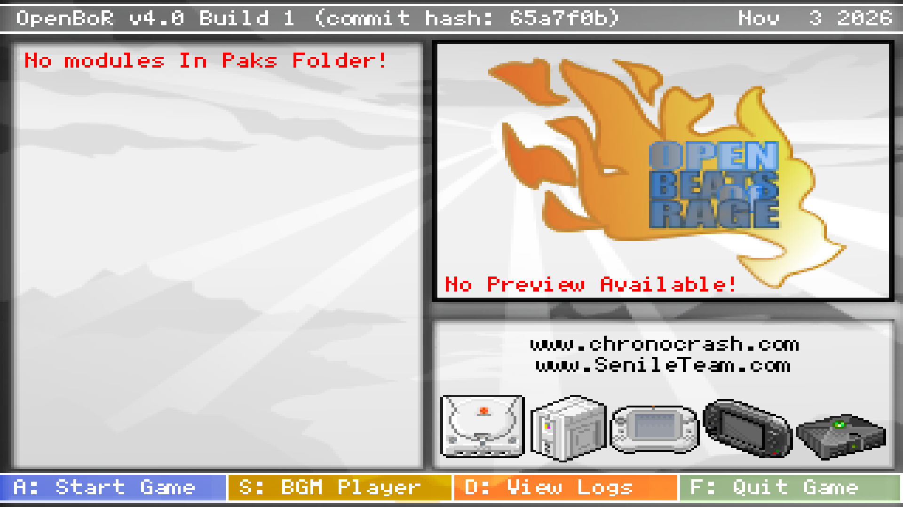

  

<h3 align="center">Game Vault · OpenBOR</h3>

  <b>OpenBOR beat 'em ups on your Xbox, with the controller.</b> 
  The OpenBOR engine for <a href="https://github.com/skitzellez/xbox-game-vault">Game Vault</a> on <b>Xbox Series X|S</b> in Dev Mode:
  pick a game in Game Vault and it plays here, then you are back in Game Vault.

<!-- gv-buttons:start -->
<!-- gv-buttons:end -->

  

## 🎮 What it is

[OpenBOR](https://github.com/DCurrent/openbor) is a free, open-source engine for side-scrolling beat 'em ups. Each game is one `.pak` file, and fans have made thousands of them. This app is that engine, made for Xbox Series X|S in Dev Mode.

**No games are included.** Bring your own `.pak` files, and only play games you have the right to play.

## 1️⃣ 2️⃣ 3️⃣ How to play

| | |
|---|---|
| **1** | Install [Game Vault](https://github.com/skitzellez/xbox-game-vault). Its setup adds this app, or press RT in Game Vault to add it with your phone. |
| **2** | Put your `.pak` files anywhere on your games USB drive. |
| **3** | Open the **OpenBOR** shelf in Game Vault and press A. |

## 🕹️ Controls

| Controller | In the game |
|---|---|
| Left stick or D-pad | Move |
| X | Attack |
| A | Jump |
| B | Special |
| Y, LB, RB | Attacks 2, 3 and 4 |
| Menu | Start |
| Hold View + Menu for 2 seconds | Back to Game Vault |

Each game can use these buttons in its own way.

## 🧩 Which games work

This app uses OpenBOR Build 7533 (2024), which plays older games as well as many newer ones. A game made for a later engine may not start.

## 📜 Credits and licence

- The OpenBOR engine: © Roel van Mastbergen & Senile Team, the OpenBOR Team and contributors. BSD-3-Clause, see [LICENSE](LICENSE). The project's own readme is kept as [README.upstream.md](README.upstream.md).
- Xbox port: Skitzelles. Files in `xbox/`, `cmake/xbox.cmake`, `engine/sdl/xbox_main.c` and `engine/sdl/xbox_audio.c`.
- Other libraries used and their licences: [xbox/licenses](xbox/licenses).

This is a modified version of OpenBOR, not made or supported by the OpenBOR Team. Please report problems with this app to Game Vault, not to them.

<!-- gv-family:start -->
<!-- gv-family:end -->
